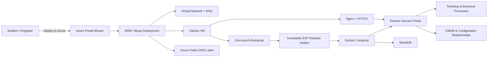

# Elrehan Service Portal (ESP) — Academy Edition

**Learn cloud automation, IT service management, business process design, ticketing, CMDB, security, and operations by building and running a real service portal on Azure.**

ESP Academy Edition is a hands-on learning platform from **Elrehan Academy**. It combines Azure infrastructure automation with a branded iTop Community service-management platform so students can see how cloud engineering and IT business processes connect in a working environment.

> **Current status:** Public Academy preview. The automated Azure deployment experience is undergoing clean-room acceptance before the v1 public release.

[](https://portal.azure.com/#view/Microsoft_Azure_CreateUIDef/CustomDeploymentBlade/uri/https%3A%2F%2Fraw.githubusercontent.com%2FElrehan-Academy%2Felrehan-service-portal-azure%2Ffeature%2Fsprint11-deploy-to-azure%2Fportal%2FmainTemplate.json/uiFormDefinitionUri/https%3A%2F%2Fraw.githubusercontent.com%2FElrehan-Academy%2Felrehan-service-portal-azure%2Ffeature%2Fsprint11-deploy-to-azure%2Fportal%2FcreateUiDefinition.json)

The button launches the branded Azure deployment wizard. Azure charges may apply for resources created in your subscription.

## Why this project exists

Cloud engineers do more than create virtual machines. In a real organization, infrastructure exists to support **services, users, applications, configuration items, requests, incidents, changes, approvals, and operational processes**.

ESP is designed as a teaching environment where students can move through that complete story:

**Business need → service request → ticket → approval/process → infrastructure automation → deployed service → CMDB/operations → validation and recovery**

Instead of learning each topic in isolation, students can observe how the pieces fit together.

## What students can learn

| Learning area | What ESP demonstrates |
| --- | --- |
| **Azure automation** | Deploy repeatable infrastructure with Bicep/ARM and a guided Azure Portal experience. |
| **Zero-touch deployment** | Bootstrap a VM and install the application automatically without laptop-side SSH installation steps. |
| **ITSM & ticketing** | Explore how service requests, incidents, changes, assignments, status transitions, and support workflows are represented in a service-management platform. |
| **Business processes** | Understand how technical automation can support request fulfilment, approvals, operational ownership, and service lifecycle processes. |
| **CMDB** | Work with configuration items and relationships so infrastructure is connected to the services it supports. |
| **Security** | Learn secure parameter handling, limited network exposure, HTTPS, certificate automation, and private application backends. |
| **Containers** | Run ESP and MariaDB with Docker Compose and persistent application/database state. |
| **Operations** | Validate health, reboot recovery, backup, restore, certificates, and application availability. |
| **Evidence-first engineering** | Prove that a deployment works with repeatable validation instead of assuming that provisioning success means application success. |

## Learning journey

ESP can be used as a practical lab platform for an Elrehan Academy learning path:

1. **Understand the service** — identify the users, business need, service, support team, and expected outcome.
2. **Explore ITSM** — create and follow tickets such as requests and incidents and understand ownership and lifecycle states.
3. **Model the environment** — learn how servers, applications, services, and dependencies belong in a CMDB.
4. **Automate the infrastructure** — deploy the Azure environment through Infrastructure as Code rather than manual portal configuration.
5. **Automate the application** — observe zero-touch installation, generated configuration, containers, and database initialization.
6. **Secure the service** — apply controlled SSH exposure, HTTPS, Let's Encrypt certificates, and private backend access.
7. **Validate the result** — confirm DNS, application health, database health, branding, HTTPS, and deployment outputs.
8. **Operate the service** — perform backup, restore, reboot, certificate-renewal, and recovery exercises.
9. **Connect technology to process** — understand how automation can eventually be triggered by approved service requests and business workflows.

The goal is not simply to deploy iTop. The goal is to help students understand the relationship between **cloud engineering, automation, service management, CMDB data, security, and business operations**.

## What gets deployed



The current Academy Edition uses a **single Azure VM** architecture intentionally. It is designed for learning, labs, demos, and POCs rather than high-availability enterprise production workloads.

## Automated Azure deployment

The Academy deployment experience asks for only the information a learner needs:

- Azure subscription, resource group, and region
- resource-name prefix
- VM size
- Linux administrator username
- SSH public-key or password authentication
- SSH access mode: My IP, custom CIDR, or disabled
- new VNet or existing subnet
- certificate email
- ESP administrator credentials

The deployment handles the remaining implementation details automatically, including:

- unique Azure DNS label generation
- Azure VM/network provisioning
- protected runtime secret delivery
- immutable ESP artifact download and SHA256 verification
- Docker and Docker Compose installation
- ESP and MariaDB deployment
- unattended ESP initialization
- Elrehan Service Portal branding
- Nginx reverse proxy
- Let's Encrypt HTTPS certificate issuance
- certificate-renewal automation
- application and database health validation

## Architecture principles

ESP Academy Edition follows a few important engineering principles:

- **Infrastructure as Code** — the environment should be reproducible.
- **Zero-touch installation** — deployment should not depend on manual SSH configuration.
- **Secure defaults** — secrets use secure Azure parameters and the ESP application listens privately on `127.0.0.1:8080` behind Nginx.
- **Immutable release artifact** — the deployment downloads a pinned release artifact and verifies its SHA256 before installation.
- **Evidence before acceptance** — infrastructure, application, database, HTTPS, certificate, and recovery behavior are validated.
- **Learn the complete system** — automation is taught together with the business process and operational context it supports.

## Current validated baseline

The project has already validated the following capabilities during earlier release acceptance:

- iTop Community 3.3.0-21411 based ESP image
- Elrehan Service Portal branding and Portal UI integration
- unattended installation
- persistent Docker Compose application and MariaDB 10.11
- Azure infrastructure automation with Bicep
- public Azure-generated FQDN
- Nginx TLS termination
- Let's Encrypt certificate issuance and renewal automation
- HTTP-to-HTTPS redirect
- private ESP backend access
- Azure VM reboot recovery
- application-aware backup and restore
- database recovery validation

The current Sprint 11 work adds the simplified public **Deploy to Azure** experience and performs a new clean-room acceptance using the same path intended for Academy users.

## Repository structure

```text
branding/          Elrehan Service Portal branding and extension assets
infra/             Azure infrastructure and zero-touch deployment automation
portal/            Azure Portal deployment template and branded UI definition
scripts/           deployment, backup, restore, HTTPS, and lifecycle automation
tests/             validation and acceptance tests
docs/              operational and engineering documentation
.github/workflows/ CI validation
```

## Operations and evidence

For lifecycle operations, backup, restore, recovery, HTTPS, certificate handling, security guidance, and engineering evidence, see the [ESP Operations Runbook](docs/operations.md).

## Academy use

This repository is published primarily for **education, labs, demonstrations, experimentation, and POCs**. Students are encouraged to inspect the automation rather than treating the Deploy to Azure button as a black box.

A useful exercise is to deploy ESP, inspect the generated Azure resources, trace how the bootstrap reaches the application installer, explore the service portal and CMDB, then destroy the lab and reproduce it again from code.

## Cost and cleanup

Deploying ESP creates billable Azure resources such as a virtual machine, disk, and public IP. Costs depend on the selected Azure region and VM size.

For training environments, use a dedicated disposable resource group and delete it when the lab is complete.

## Project direction

The Academy Edition is the first step. Future learning and product work can extend the same foundation toward:

- service-catalog driven automation
- approval-to-deployment workflows
- richer observability and reporting
- automated ticket-to-infrastructure processes
- deeper CMDB synchronization
- enterprise and highly available deployment models

---

**Elrehan Academy** — learn by building, automating, validating, and operating real systems.
