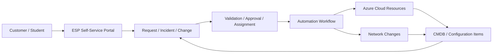
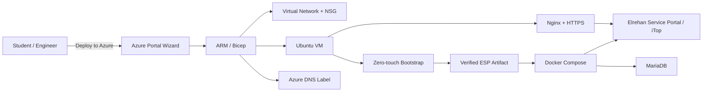

# Elrehan Service Portal (ESP) — Academy Edition

**Learn ITIL-style service management and customer self-service automation by running a real service portal on Azure.**

ESP Academy Edition is a hands-on learning environment from **Elrehan Academy**, built on iTop Community and Azure automation.

The project focuses on two practical learning goals:

1. **ITIL-related service management using iTop** — requests, incidents, changes, configuration items, CMDB relationships, assignments, status flows, and service operations.
2. **Cloud and network automation from a customer self-service portal** — showing how an approved request can become an automated infrastructure or network action.

> **Current status:** Public Academy preview. The Deploy to Azure experience is being validated through clean-room acceptance before the v1 public release.

[](https://portal.azure.com/#view/Microsoft_Azure_CreateUIDef/CustomDeploymentBlade/uri/https%3A%2F%2Fraw.githubusercontent.com%2FElrehan-Academy%2Felrehan-service-portal-azure%2Ffeature%2Fsprint11-deploy-to-azure%2Fportal%2FmainTemplate.json/uiFormDefinitionUri/https%3A%2F%2Fraw.githubusercontent.com%2FElrehan-Academy%2Felrehan-service-portal-azure%2Ffeature%2Fsprint11-deploy-to-azure%2Fportal%2FuiFormDefinition.json)

The button launches the branded **Elrehan Academy — ESP Academy Edition** Azure deployment wizard. Azure charges may apply for resources created in your subscription.

## What students can learn

### 1. ITIL-style service management in iTop

ESP gives students a real service-management platform to explore familiar operational concepts such as:

- customer and user requests
- incidents and support tickets
- changes and implementation tracking
- assignment to teams or engineers
- ticket states and lifecycle transitions
- services and service ownership
- configuration items
- CMDB relationships between applications, servers, network components, and services
- operational history and traceability

The goal is to understand how IT service-management processes are represented in a working tool rather than only as theory.

### 2. Customer self-service for cloud and network automation

The second learning goal is to connect service management with automation.

A typical learning pattern is:

**Customer request → service portal → validation / approval → automation workflow → cloud or network change → result recorded back in the service process**

Examples that can be built on top of ESP include:

- request a new Azure lab environment
- request a new VNet or subnet
- request a network security rule
- request a VM or application environment
- request access to an existing environment
- request a DNS or connectivity change
- trigger approved Infrastructure as Code deployment
- update the related CMDB record after deployment
- attach deployment evidence or status to the originating request

The current repository provides the Azure deployment foundation and service-management platform needed for these labs. Individual catalog-to-automation workflows can then be added progressively as training exercises.

## How the two areas connect



This allows students to see the full relationship between **service management and technical automation**.

## Deploy ESP to Azure

The Academy deployment experience is designed to be simple enough for labs while still exposing useful infrastructure choices.

Students select:

- Azure subscription, resource group, and region
- resource-name prefix
- VM size
- Linux administrator username
- SSH public-key or password authentication
- SSH access mode: My IP, custom CIDR, or disabled
- new VNet or existing subnet
- certificate email
- ESP administrator credentials

The deployment then automates:

- Azure VM and networking deployment
- generated Azure DNS name
- protected runtime secret delivery
- immutable ESP artifact download
- SHA256 artifact validation
- Docker and Docker Compose installation
- ESP and MariaDB deployment
- unattended ESP installation
- Elrehan Service Portal branding
- Nginx reverse proxy
- Let's Encrypt HTTPS certificate issuance
- certificate-renewal automation
- application and database health validation

Academy-created Azure resources are automatically tagged with `application=Elrehan Service Portal`, `project=ESP`, and `managedBy=Bicep`.

## Current architecture



The Academy Edition intentionally uses a **single Azure VM**. It is intended for education, labs, demos, and POCs rather than high-availability enterprise production workloads.

## Learning path

A practical ESP lab sequence can be:

1. Deploy ESP automatically to Azure.
2. Log in to the service portal and explore iTop objects and ticket workflows.
3. Create services, configuration items, and CMDB relationships.
4. Create requests, incidents, and changes and follow their lifecycle.
5. Build a simple customer catalog item for a cloud or network request.
6. Connect that request to an automation script, pipeline, or Infrastructure as Code workflow.
7. Return deployment status or evidence to the service-management process.
8. Update the CMDB when infrastructure is created or changed.
9. Practice backup, restore, reboot recovery, HTTPS, and operational validation.

This keeps the training focused on two skills that are commonly used together in real environments: **IT service management** and **infrastructure automation**.

## Current validated baseline

The project has already validated:

- iTop Community 3.3.0-21411 based ESP image
- Elrehan Service Portal branding
- unattended installation
- persistent Docker Compose deployment
- MariaDB 10.11
- Azure infrastructure automation with Bicep
- public Azure-generated FQDN
- Nginx TLS termination
- Let's Encrypt certificate issuance
- automatic certificate renewal
- HTTP-to-HTTPS redirect
- private ESP backend access
- Azure VM reboot recovery
- application-aware backup and restore
- database recovery validation

The current Sprint 11 work adds the simplified public **Deploy to Azure** experience and clean-room validation using the same path intended for Academy users.

## Repository structure

```text
branding/          Elrehan Service Portal branding and extension assets
infra/             Azure infrastructure and zero-touch deployment automation
portal/            Azure Portal deployment template and UI definition
scripts/           deployment, backup, restore, HTTPS, and lifecycle automation
tests/             validation and acceptance tests
docs/              operational and engineering documentation
.github/workflows/ CI validation
```

## Operations

For lifecycle operations, backup, restore, HTTPS, certificate handling, security guidance, and engineering evidence, see the [ESP Operations Runbook](docs/operations.md).

## Cost and cleanup

Deploying ESP creates billable Azure resources such as a virtual machine, managed disk, and public IP. Costs depend on Azure region and VM size.

For training, use a disposable resource group and delete it when the lab is complete.

## Project direction

Future Academy exercises can extend the same platform with:

- service catalog items for cloud and network requests
- approval-to-deployment workflows
- Azure DevOps or GitHub Actions integration
- API-driven network automation
- CMDB updates from automation
- deployment status written back to tickets
- richer reporting and observability

---

**Elrehan Academy** — learn IT service management and automation by building real workflows.
